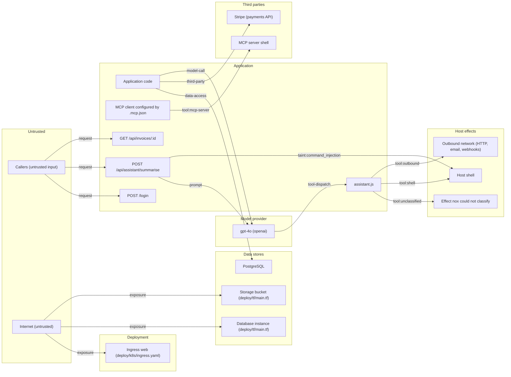

# Threat model: system evidence from a nox scan

> This is a system description and threat evidence assembled from an automated scan, offered as input to a threat model that people make. It lists what nox can evidence and what it cannot see. A category with no evidence is not evidenced either way, and that is not an assurance. Nothing here decides whether a threat is real or what should be done about it.

## What this was built from

- Scan: nox 1.2.3, generated 2026-10-24T17:18:36Z
- Repository revision when this model was written: `0123456789abcdef0123456789abcdef01234567` (the scan may have run at an earlier one)
- Scopes scanned: all
- `findings.json` (findings), SHA-256 `aa`
- `sbom.cdx.json` (sbom), SHA-256 `bb`
- `ai.inventory.json` (ai-inventory), SHA-256 `cc`
- Routes: read; AI inventory: read; SBOM: read

## Summary

- 19 elements, 16 data flows, 12 trust boundaries
- STRIDE cells: 9 open issues, 3 leads to verify, 6 context only, 54 not evidenced
- 2 active finding(s) belong to no modelled element; see `findings.json`
- 13 questions for the team

## System elements

### Entry points (routes)

| Element | Where | Notes |
|---|---|---|
| GET /api/invoices/:id | `src/routes/invoices.js:13` | authentication middleware: requireAuth; authorization lead: yes |
| POST /api/assistant/summarise | `src/routes/assistant.js:27` | authentication middleware: requireAuth |
| POST /login | `src/server.js:6` | authentication middleware: none visible |

### AI agents

| Element | Where | Notes |
|---|---|---|
| assistant.js | `src/routes/assistant.js` | tools: query_db (capability not classified); run_shell (shell_exec); send_email (email_send) |

### Models

| Element | Where | Notes |
|---|---|---|
| gpt-4o (openai) | `src/routes/assistant.js:28` | provider: openai; pinned: false; credential env var: OPENAI_API_KEY |

### MCP servers

| Element | Where | Notes |
|---|---|---|
| MCP server shell | `.mcp.json` | tools: *; command: npx; args: -y mcp-server-shell |

### MCP clients

| Element | Where | Notes |
|---|---|---|
| MCP client configured by .mcp.json | `.mcp.json` | MCP configuration file naming the servers an agent runtime launches |

### Data stores

| Element | Where | Notes |
|---|---|---|
| Storage bucket (deploy/tf/main.tf) | `deploy/tf/main.tf:3` | resource: bucket |
| Database instance (deploy/tf/main.tf) | `deploy/tf/main.tf:31` | resource: database |
| PostgreSQL | - | basis: dependency |

### External services

| Element | Where | Notes |
|---|---|---|
| Stripe (payments API) | - | basis: dependency |

### Ingress

| Element | Where | Notes |
|---|---|---|
| Ingress web (deploy/k8s/ingress.yaml) | `deploy/k8s/ingress.yaml:2` | IAC-149: Kubernetes Ingress without TLS configuration |

### Dependencies

| Element | Where | Notes |
|---|---|---|
| Third-party dependencies (4 packages) | - | 4 packages in CycloneDX 1.5 |

### Actors

| Element | Where | Notes |
|---|---|---|
| Callers (untrusted input) | - | origin of untrusted input; present because a flow starts here |
| Internet (untrusted) | - | origin of untrusted traffic; present because a deployment resource is reachable from it |

### Host capabilities reached

| Element | Where | Notes |
|---|---|---|
| Outbound network (HTTP, email, webhooks) | - | tool registration in the AI inventory |
| Host shell | - | tool registration in the AI inventory |
| Effect nox could not classify | - | tool registration in the AI inventory |

## Data flows and trust boundaries

| Trust boundary | Flows |
|---|---|
| application → data store (`data-access`) | 1 |
| internet → exposed deployment resource (`exposure`) | 3 |
| application → model provider (`model-call`) | 1 |
| untrusted input → LLM prompt (`prompt`) | 1 |
| untrusted caller → route (`request`) | 3 |
| untrusted input → shell command (`taint:command_injection`) | 1 |
| application → third-party service (`third-party`) | 1 |
| model output → agent tool dispatch (`tool-dispatch`) | 1 |
| model output → MCP server tool (`tool:mcp-server`) | 1 |
| model output → outbound network (`tool:outbound`) | 1 |
| model output → shell (`tool:shell`) | 1 |
| model output → tool with a capability nox could not classify (`tool:unclassified`) | 1 |

### application → data store

- Application code → PostgreSQL: a package for PostgreSQL is in the dependency set
  - evidence: package pg@8.13.1 is in the dependency set; the SBOM does not say whether it is direct or transitive (`pg@8.13.1`, sbom.cdx.json)

### internet → exposed deployment resource

- Internet (untrusted) → Storage bucket (deploy/tf/main.tf): Storage bucket (deploy/tf/main.tf) is reachable from outside
  - evidence: IAC-040: S3 bucket with public ACL (`deploy/tf/main.tf:3`, findings.json)
- Internet (untrusted) → Database instance (deploy/tf/main.tf): Database instance (deploy/tf/main.tf) is reachable from outside
  - evidence: IAC-036: RDS or database instance is publicly accessible (`deploy/tf/main.tf:32`, findings.json)
- Internet (untrusted) → Ingress web (deploy/k8s/ingress.yaml): Ingress web (deploy/k8s/ingress.yaml) is reachable from outside
  - evidence: IAC-149: Kubernetes Ingress without TLS configuration (`deploy/k8s/ingress.yaml:2`, findings.json)

### application → model provider

- Application code → gpt-4o (openai): the application calls model gpt-4o
  - evidence: model `gpt-4o` is referenced by the application code (`src/routes/assistant.js:28`, ai.inventory.json)

### untrusted input → LLM prompt

- POST /api/assistant/summarise → gpt-4o (openai): untrusted input reaches the LLM prompt call at src/routes/assistant.js:28
  - evidence: TAINT-AI-001: Untrusted input reaches prompt_injection sink "openai.chat.completions.create" (`src/routes/assistant.js:28`, findings.json)

### untrusted caller → route

- Callers (untrusted input) → GET /api/invoices/:id: request reaches GET /api/invoices/:id (authentication middleware: requireAuth)
  - evidence: route registration read by the authorization reader (Express) (`src/routes/invoices.js:13`, findings.json)
- Callers (untrusted input) → POST /api/assistant/summarise: request reaches POST /api/assistant/summarise (authentication middleware: requireAuth)
  - evidence: route registration read by the authorization reader (Express) (`src/routes/assistant.js:27`, findings.json)
- Callers (untrusted input) → POST /login: request reaches POST /login (no authentication middleware visible)
  - evidence: route registration read by the authorization reader (Express) (`src/server.js:6`, findings.json)

### untrusted input → shell command

- POST /api/assistant/summarise → Host shell: untrusted input (http_query) reaches a shell command sink
  - evidence: TAINT-001: Untrusted input reaches command_injection sink (`src/routes/assistant.js:40`, findings.json)

### application → third-party service

- Application code → Stripe (payments API): a package for Stripe (payments API) is in the dependency set
  - evidence: package stripe@17.4.0 is in the dependency set; the SBOM does not say whether it is direct or transitive (`stripe@17.4.0`, sbom.cdx.json)

### model output → agent tool dispatch

- gpt-4o (openai) → assistant.js: model output drives the agent's tool calls (prompt call and agent are registered in the same file; nox does not trace the call)
  - evidence: TAINT-AI-001: Untrusted input reaches prompt_injection sink "openai.chat.completions.create" (`src/routes/assistant.js:28`, findings.json)

### model output → MCP server tool

- MCP client configured by .mcp.json → MCP server shell: model output may call tools on MCP server shell
  - evidence: MCP server `shell` is configured (`.mcp.json`, ai.inventory.json)
  - evidence: MCP server `shell` is configured, launched as `npx -y mcp-server-shell` (`.mcp.json`, ai.inventory.json)

### model output → outbound network

- assistant.js → Outbound network (HTTP, email, webhooks): model output may invoke send_email (email_send)
  - evidence: agent registers tool(s) send_email with capability email_send (`src/routes/assistant.js`, ai.inventory.json)

### model output → shell

- assistant.js → Host shell: model output may invoke run_shell (shell_exec)
  - evidence: agent registers tool(s) run_shell with capability shell_exec (`src/routes/assistant.js`, ai.inventory.json)

### model output → tool with a capability nox could not classify

- assistant.js → Effect nox could not classify: model output may invoke query_db (capability not classified)
  - evidence: agent registers tool(s) query_db with no capability nox recognises (`src/routes/assistant.js`, ai.inventory.json)

### Diagram

## STRIDE by element

Each cell holds the evidence nox has for one element and one category. `open N` is N active findings; `lead` is something worth checking that is not a finding; `context` is evidence that describes the element without anything open; `none` means **nox has no evidence either way**.

| Element | S | T | R | I | D | E |
|---|---|---|---|---|---|---|
| assistant.js | none | open 3 | none | none | none | open 3 |
| Third-party dependencies (4 packages) | none | none | none | none | none | none |
| Storage bucket (deploy/tf/main.tf) | none | none | none | none | none | open 1 |
| Database instance (deploy/tf/main.tf) | none | none | none | context | none | open 1 |
| Ingress web (deploy/k8s/ingress.yaml) | none | none | none | open 1 | none | none |
| MCP server shell | none | context | none | none | none | context |
| gpt-4o (openai) | context | open 2 | none | none | none | open 2 |
| GET /api/invoices/:id | context | none | none | lead | none | lead |
| POST /api/assistant/summarise | context | open 2 | none | none | none | open 2 |
| POST /login | lead | none | none | none | none | none |
| Stripe (payments API) | none | none | none | none | none | none |
| PostgreSQL | none | none | none | none | none | none |

### assistant.js

`agent:src/routes/assistant.js`. Categories not listed: nox has no evidence either way.

- **Tampering** (open issues)
  - AI-AGENT-001: Agent exposes shell_exec (`src/routes/assistant.js:1`, findings.json)
  - TAINT-001: Untrusted input reaches command_injection sink (`src/routes/assistant.js:40`, findings.json)
  - TAINT-AI-001: Untrusted input reaches prompt_injection sink "openai.chat.completions.create" (`src/routes/assistant.js:28`, findings.json)
- **Elevation of privilege** (open issues)
  - AI-AGENT-001: Agent exposes shell_exec (`src/routes/assistant.js:1`, findings.json)
  - TAINT-001: Untrusted input reaches command_injection sink (`src/routes/assistant.js:40`, findings.json)
  - TAINT-AI-001: Untrusted input reaches prompt_injection sink "openai.chat.completions.create" (`src/routes/assistant.js:28`, findings.json)
  - the agent exposes these tools to the model: query_db (capability not classified); run_shell (shell_exec); send_email (email_send) (`src/routes/assistant.js`, ai.inventory.json)

### Third-party dependencies (4 packages)

`dependencies`. Categories not listed: nox has no evidence either way.

- **Findings with no STRIDE category** (the weakness they declare is not one this mapping covers)
  - VULN-001: Known vulnerability GHSA-xxxx in axios@1.7.4 (`package-lock.json:1`, findings.json)

### Storage bucket (deploy/tf/main.tf)

`deploy:bucket@deploy/tf/main.tf`. Categories not listed: nox has no evidence either way.

- **Elevation of privilege** (open issues)
  - IAC-040: S3 bucket with public ACL (`deploy/tf/main.tf:3`, findings.json)

### Database instance (deploy/tf/main.tf)

`deploy:database@deploy/tf/main.tf`. Categories not listed: nox has no evidence either way.

- **Information disclosure** (context only)
  - IAC-037: RDS storage encryption disabled [waived] (`deploy/tf/main.tf:31`, findings.json)
- **Elevation of privilege** (open issues)
  - IAC-036: RDS or database instance is publicly accessible (`deploy/tf/main.tf:32`, findings.json)

### Ingress web (deploy/k8s/ingress.yaml)

`deploy:ingress@deploy/k8s/ingress.yaml`. Categories not listed: nox has no evidence either way.

- **Information disclosure** (open issues)
  - IAC-149: Kubernetes Ingress without TLS configuration (`deploy/k8s/ingress.yaml:2`, findings.json)

### MCP server shell

`mcp:shell@.mcp.json`. Categories not listed: nox has no evidence either way.

- **Tampering** (context only)
  - launched with `npx` from package `mcp-server-shell` with no version pinned, so what runs is whatever the registry serves at launch (`.mcp.json`, ai.inventory.json)
- **Elevation of privilege** (context only)
  - the configuration does not limit which of the server's tools the client may call (tool list `*`) (`.mcp.json`, ai.inventory.json)

### gpt-4o (openai)

`model:gpt-4o@src/routes/assistant.js`. Categories not listed: nox has no evidence either way.

- **Spoofing** (context only)
  - the call authenticates with the credential in environment variable `OPENAI_API_KEY`; where it is stored and who can read it is outside the scan (`src/routes/assistant.js:28`, ai.inventory.json)
- **Tampering** (open issues)
  - TAINT-001: Untrusted input reaches command_injection sink (`src/routes/assistant.js:40`, findings.json)
  - TAINT-AI-001: Untrusted input reaches prompt_injection sink "openai.chat.completions.create" (`src/routes/assistant.js:28`, findings.json)
  - the model reference is not pinned to a revision, so the provider may change its behaviour without a change here (`src/routes/assistant.js:28`, ai.inventory.json)
- **Elevation of privilege** (open issues)
  - TAINT-001: Untrusted input reaches command_injection sink (`src/routes/assistant.js:40`, findings.json)
  - TAINT-AI-001: Untrusted input reaches prompt_injection sink "openai.chat.completions.create" (`src/routes/assistant.js:28`, findings.json)

### GET /api/invoices/:id

`route:GET /api/invoices/:id`. Categories not listed: nox has no evidence either way.

- **Spoofing** (context only)
  - authentication middleware `requireAuth` is on the route's chain; nox reads middleware by name and does not evaluate that it works (`src/routes/invoices.js:13`, findings.json)
- **Information disclosure** (leads to verify)
  - lead: GET /api/invoices/:id loads a record by a caller-supplied id with no visible ownership check. Test it with two user accounts. (`src/routes/invoices.js:14`, findings.json)
- **Elevation of privilege** (leads to verify)
  - lead: GET /api/invoices/:id loads a record by a caller-supplied id with no visible ownership check. Test it with two user accounts. (`src/routes/invoices.js:14`, findings.json)

### POST /api/assistant/summarise

`route:POST /api/assistant/summarise`. Categories not listed: nox has no evidence either way.

- **Spoofing** (context only)
  - authentication middleware `requireAuth` is on the route's chain; nox reads middleware by name and does not evaluate that it works (`src/routes/assistant.js:27`, findings.json)
- **Tampering** (open issues)
  - TAINT-001: Untrusted input reaches command_injection sink (`src/routes/assistant.js:40`, findings.json)
  - TAINT-AI-001: Untrusted input reaches prompt_injection sink "openai.chat.completions.create" (`src/routes/assistant.js:28`, findings.json)
- **Elevation of privilege** (open issues)
  - TAINT-001: Untrusted input reaches command_injection sink (`src/routes/assistant.js:40`, findings.json)
  - TAINT-AI-001: Untrusted input reaches prompt_injection sink "openai.chat.completions.create" (`src/routes/assistant.js:28`, findings.json)

### POST /login

`route:POST /login`. Categories not listed: nox has no evidence either way.

- **Spoofing** (leads to verify)
  - no authentication middleware is visible on the route's chain; this is a route that is either public on purpose or checks the caller somewhere nox does not read (`src/server.js:6`, findings.json)

## Questions for the team

Each question comes from a gap in the evidence, not from a judgement that something is wrong.

1. assistant.js registers tool query_db (Run a SQL query) and nox does not recognise its capability: what can it reach?
2. assistant.js exposes shell_exec to the model through tool run_shell: who may trigger it, and what confirms the request is allowed?
3. assistant.js exposes email_send to the model through tool send_email: who may trigger it, and what confirms the request is allowed?
4. Which components may query PostgreSQL, with which credentials and privileges?
5. Storage bucket (deploy/tf/main.tf) is reachable from outside according to IAC-040: is that intended, and who needs that access?
6. Database instance (deploy/tf/main.tf) is reachable from outside according to IAC-036: is that intended, and who needs that access?
7. Ingress web (deploy/k8s/ingress.yaml) is reachable from outside according to IAC-149: is that intended, and who needs that access?
8. MCP server shell (`npx -y mcp-server-shell`) is configured in .mcp.json: who approves adding a server like this, and what can it reach on the machine that runs it?
9. Model gpt-4o is not pinned to a revision: who notices when the provider changes its behaviour?
10. POST /login (src/server.js:6) has no authentication middleware visible: is it meant to be callable without authentication?
11. GET /api/invoices/:id (src/routes/invoices.js:14) loads a record by a caller-supplied id with no visible ownership check: how does it make sure a caller reads only their own record? Test it with two accounts.
12. What data reaches model gpt-4o in prompts, and is any of it data the application promises to keep private?
13. What data does the application send to Stripe (payments API), and who holds its credentials?

## What nox cannot see

- Business logic and intent. Nox cannot tell a route that is public on purpose from one that is unprotected by mistake, or a record that is shared by design from one that leaks.
- Runtime configuration: environment variables, feature flags, secret stores and anything set outside the repository.
- The identity provider, session handling and token validation behind authentication. Middleware is read by name; nox does not evaluate whether it works.
- Network topology beyond what infrastructure-as-code findings show: firewalls, service meshes, VPNs, peering, and what a load balancer actually forwards.
- Entry points. Routes are read only from Express-style and Fastify servers (JavaScript and TypeScript) and Flask and FastAPI applications (Python), and authorization leads come from the same readers. NestJS decorators, Next.js handlers, Django, Go, Java and other frameworks are not enumerated, and neither are gRPC services, queue consumers or scheduled jobs.
- Infrastructure. Only resources that an infrastructure rule reported on appear. A resource with nothing to report is not in this model.
- Dependencies. Packages are known from the SBOM, which does not say whether a package is direct or transitive. A data store or service inferred from a package shows the application can reach it, not that it does.
- Data flows are static and name-level. A flow joins two elements because the scan connects them (the same file, a taint finding, a dependency, a configuration entry). Nox does not trace calls between routes, services and stores, and does not see data at rest or in transit.
- Data sensitivity. Nox attaches DATA-* findings to the element in the file they were found in; it does not classify what each store holds.
- Findings are attached to elements by file, and to a route by the nearest registration above them in the same file. A finding in a shared helper is attached to no route, and a finding in a file with no modelled element appears only in the unattributed count.
- STRIDE categories come from the weakness (CWE) a rule declares. A finding with no weakness, or with one the mapping does not cover, is listed apart from the table, not forced into a category.
- Third-party services, model providers and the contents of MCP servers are outside the scan.
- A cell with no evidence means nox has none. It does not mean there is nothing to find.

